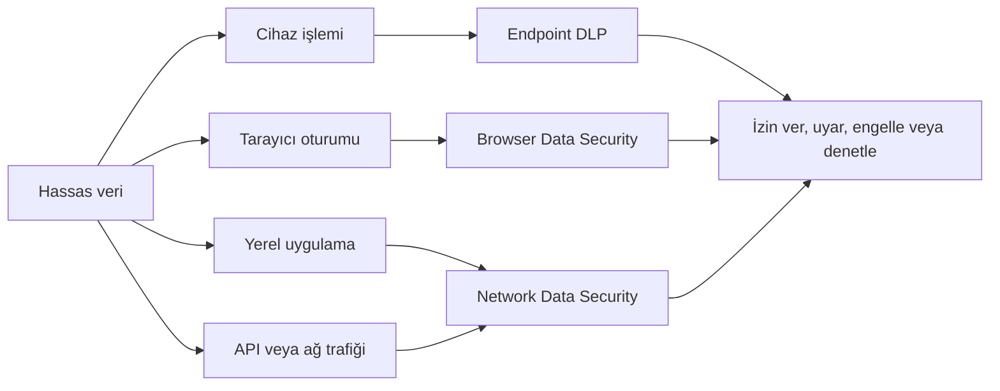
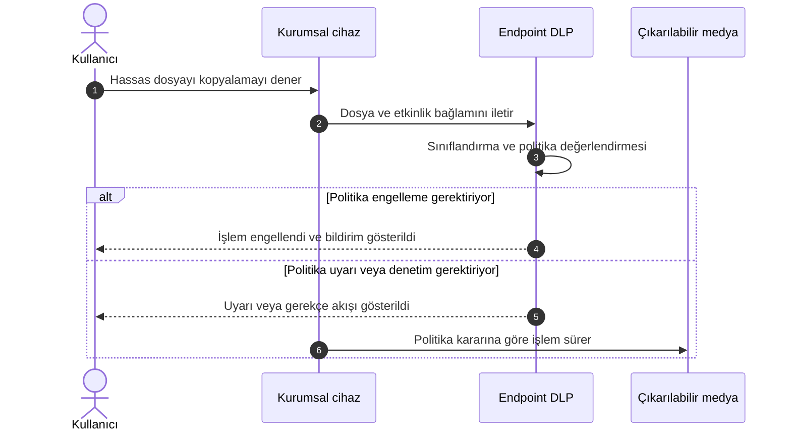
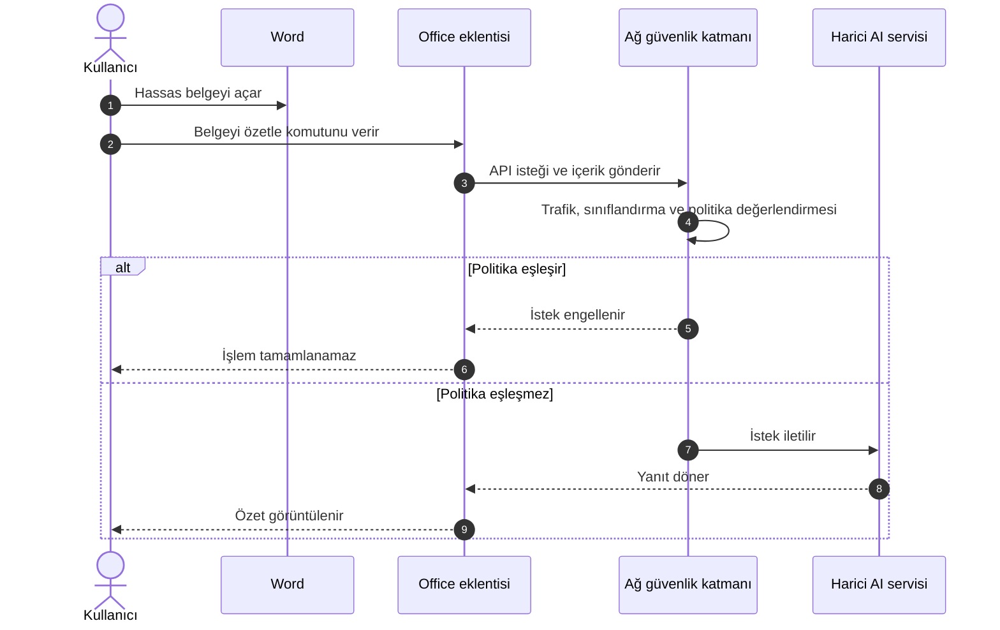
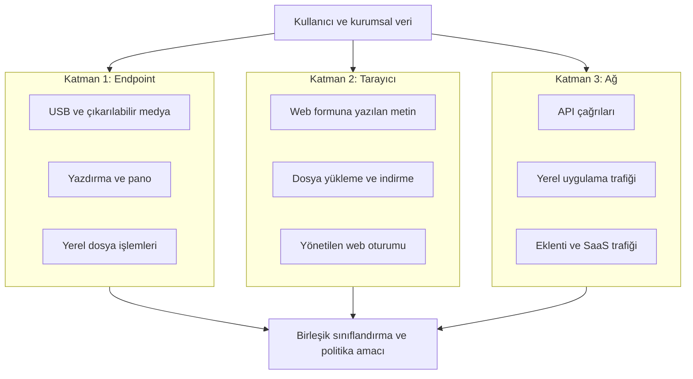
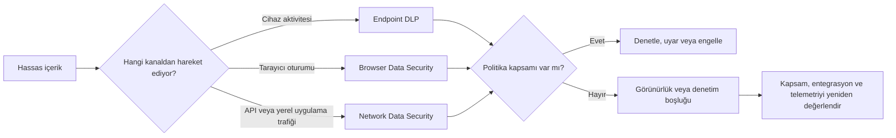
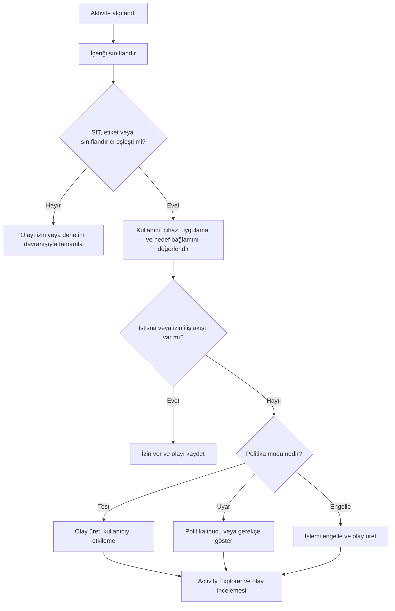
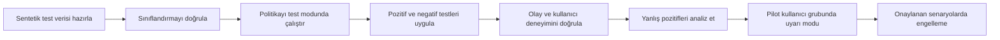
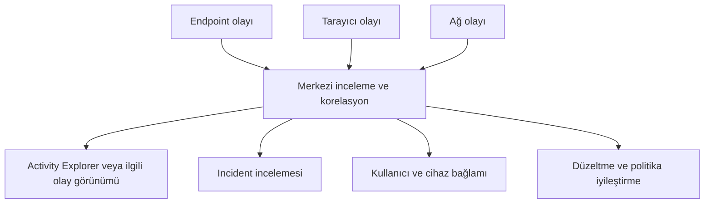
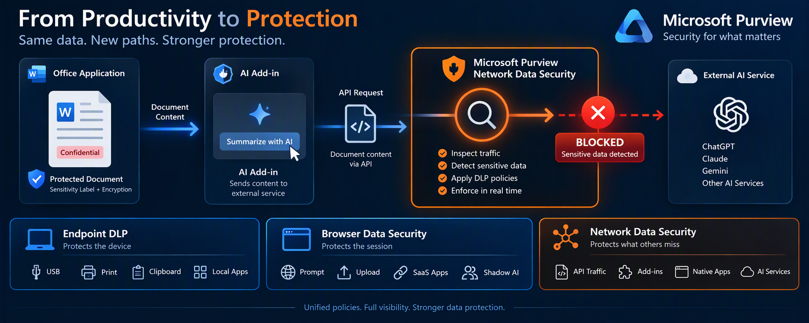
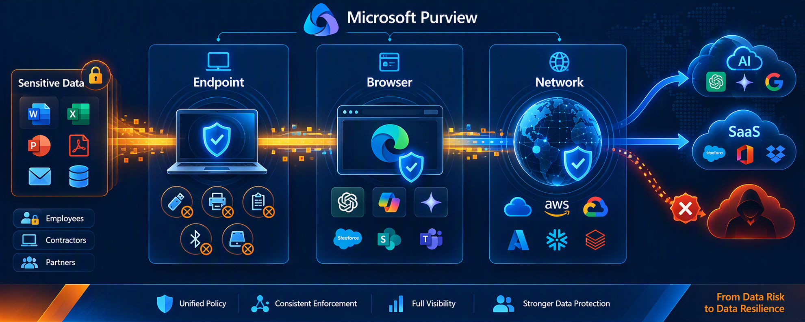

# Microsoft Purview Layered Protection: Veri Artık Bir Dosya Değil, Bir Akış

> Bir dosyanın USB belleğe kopyalanmasını engellemek veri güvenliğinin yalnızca bir bölümüdür. Aynı verinin bir yapay zekâ istemine, Office eklentisine, yerel uygulamaya veya API isteğine dönüşmesi durumunda koruma farklı bir katmanda devam etmelidir.

<p align="center">
  
</p>

> [!NOTE]
> Bu makale, Microsoft Purview'ın katmanlı veri koruma yaklaşımını teknik ve öğrenme odaklı biçimde açıklamaktadır. Ürün yetenekleri, lisanslama, önizleme durumu ve desteklenen entegrasyonlar zaman içinde değişebileceğinden üretim tasarımından önce güncel Microsoft belgeleri doğrulanmalıdır.

## İçindekiler

- [1. Neden katmanlı veri koruması?](#1-neden-katmanlı-veri-koruması)
- [2. Örnek olay: Kaçmaya çalışan finans raporu](#2-örnek-olay-kaçmaya-çalışan-finans-raporu)
- [3. Üç koruma katmanının teknik rolü](#3-üç-koruma-katmanının-teknik-rolü)
- [4. The Void: Görünürlük ve denetim boşluğu](#4-the-void-görünürlük-ve-denetim-boşluğu)
- [5. Politika karar akışı](#5-politika-karar-akışı)
- [6. Kapsama matrisi](#6-kapsama-matrisi)
- [7. Müşteri ortamında PoC tasarımı](#7-müşteri-ortamında-poc-tasarımı)
- [8. Üretim mimarisi için uygulama yaklaşımı](#8-üretim-mimarisi-için-uygulama-yaklaşımı)
- [9. İzleme, olay doğrulama ve operasyon](#9-izleme-olay-doğrulama-ve-operasyon)
- [10. Teknik uyarılar ve ürün sınırlamaları](#10-teknik-uyarılar-ve-ürün-sınırlamaları)
- [11. Sonuç](#11-sonuç)
- [Kaynakça](#kaynakça)

---

## 1. Neden katmanlı veri koruması?

Geleneksel DLP tasarımlarında veri çoğunlukla dosya, e-posta eki veya cihaz üzerindeki kullanıcı işlemi olarak değerlendirilirdi. Bu yaklaşım USB, yazdırma, panoya kopyalama ve belirli dosya aktarım kanalları için hâlâ önemlidir. Ancak modern iş akışlarında hassas içerik aynı zamanda bir web formuna yazılan metin, üretken yapay zekâ istemi, masaüstü uygulamasının ağ trafiği, Office eklentisinin API isteği veya SaaS oturumundaki yükleme işlemi olabilir.

Bu nedenle modern veri güvenliği mimarisinde iki ayrı soru sorulmalıdır:

1. **İçerik nedir?** Hassas bilgi türü, sınıflandırıcı, eğitimli sınıflandırıcı veya duyarlılık etiketi ne söylüyor?
2. **İçerik hangi kanaldan hareket ediyor?** Cihaz işlemi, tarayıcı oturumu, yerel uygulama veya ağ trafiği mi?

Microsoft Purview Layered Protection yaklaşımı, tek bir denetimin bütün kanalları eksiksiz kapsadığı varsayımı yerine, her katmanın güçlü olduğu veri hareketine odaklanır.



Bu şema bir ürünün diğerinin yerine geçtiğini değil, farklı görünürlük noktalarının birlikte çalıştığını gösterir.

---

## 2. Örnek olay: Kaçmaya çalışan finans raporu

Bir finans kullanıcısının aşağıdaki alanları içeren bir Excel raporu hazırladığını düşünelim:

- Müşteri adı ve iletişim bilgileri
- T.C. kimlik numarası
- IBAN
- Ödeme kartı bilgileri
- Maaş ve yan hak verileri

Dosyaya kurumun taksonomisine göre **Çok Gizli** etiketi uygulanmıştır. İçerikte ayrıca Purview tarafından algılanabilecek hassas bilgi türleri bulunur. Kullanıcının amacı kötü niyetli olmak zorunda değildir. Kullanıcı veriyi analiz ettirmek, özetlemek veya başka bir uygulamada kullanmak isteyebilir. DLP açısından önemli olan yalnızca niyet değil, içeriğin ve veri hareketinin oluşturduğu risktir.

### 2.1 USB aktarımı

Kullanıcı dosyayı çıkarılabilir medyaya kopyalamaya çalışır. Bu, cihaz bağlamındaki bir eylemdir. Endpoint DLP politikası dosyanın içeriğine, etiketine, kullanıcı kapsamına ve hedef aktiviteye göre denetim, uyarı veya engelleme kararı verebilir.



### 2.2 Web tabanlı yapay zekâ istemi

Kullanıcı aynı içeriği bir tüketici yapay zekâ uygulamasının web arayüzüne yapıştırır. Bu kez veri bir dosya transferi değil, tarayıcı oturumundaki yazılı içeriktir. Tarayıcı katmanı, desteklenen senaryolarda yazılan metin veya dosya yükleme eylemine paylaşım gerçekleşmeden önce müdahale edebilir.

### 2.3 Office eklentisi veya yerel uygulama

Kullanıcı belgeyi Word içinde açar ve üçüncü taraf bir eklentiyle özetletir. Eklenti belge içeriğini bir API çağrısına dönüştürebilir. Kullanıcı tarayıcı açmamış ve USB kullanmamıştır. Böyle bir desen, cihaz ve tarayıcı denetimlerinin kapsamı dışında kalabilecek bir ağ akışı oluşturur. Ağ katmanı, desteklenen entegrasyona ve trafik görünürlüğüne bağlı olarak bu boşluğu değerlendirmek için konumlandırılır.



> [!IMPORTANT]
> Yukarıdaki senaryo kavramsal bir veri akışıdır. Gerçek görünürlük; desteklenen uygulamaya, trafik yönlendirmesine, şifreli trafik işleme yaklaşımına, kullanılan SASE veya proxy entegrasyonuna ve ürünün güncel destek matrisine bağlıdır.

---

## 3. Üç koruma katmanının teknik rolü

### 3.1 Endpoint DLP

Endpoint DLP, cihaz üzerinde gerçekleşen hassas veri aktivitelerine odaklanır. Tipik tasarım alanları çıkarılabilir medya, yazdırma, pano, ağ paylaşımı ve uygulama tabanlı dosya işlemleridir. Endpoint katmanının ayırt edici avantajı, işlemi kullanıcı cihazındaki bağlamla ilişkilendirebilmesidir.

Bir Endpoint DLP politikasının değerlendirilmesinde şu bileşenler birlikte düşünülmelidir:

- Hassas bilgi türleri ve eşik değerleri
- Duyarlılık etiketleri
- Kullanıcı ve grup kapsamı
- Cihazın onboarding ve yapılandırma durumu
- Hedef domain, uygulama veya cihaz grubu
- Denetim, uyarı, gerekçeli geçersiz kılma ve engelleme davranışı
- Politika önceliği ve istisnalar

Endpoint DLP, ağ katmanının alternatifi değildir. Çevrimdışı veya yerel cihaz aktivitelerinde ağ denetiminin göremeyeceği bağlamı sağlar.

### 3.2 Browser Data Security

Browser Data Security, desteklenen tarayıcı ve oturum senaryolarında kullanıcının hassas veriyi web uygulamasına yazdığı, yapıştırdığı, yüklediği veya indirdiği noktaya odaklanır. Değeri, veriyi yalnızca hedefine ulaştıktan sonra raporlamak yerine kullanıcı etkileşimi sırasında politika uygulayabilmesidir.

Bu katman tasarlanırken aşağıdaki sorular yanıtlanmalıdır:

- Kurumsal olarak desteklenen tarayıcı hangisidir?
- Edge for Business veya gerekli tarayıcı uzantıları nasıl yönetilecektir?
- Kurumsal cihaz ve BYOD senaryoları nasıl ayrıştırılacaktır?
- Yönetilen ve yönetilmeyen uygulama tanımları nelerdir?
- Domain grupları ve bulut uygulaması kategorileri nasıl yönetilecektir?
- Kullanıcıya gösterilecek politika mesajı ve geçersiz kılma davranışı nedir?

### 3.3 Network Data Security

Network Data Security, veri hareketini ağ üzerinden değerlendiren katmandır. Katmanlı mimaride özellikle tarayıcı dışı uygulamalar, eklentiler, API tabanlı iletişim ve desteklenen yerel uygulama trafiği için önem kazanır.

Bu katmanın çalışması yalnızca Purview politikasına bağlı değildir. Trafiğin desteklenen bir ağ güvenliği mimarisinden geçirilmesi ve Purview ile gerekli entegrasyonun sağlanması gerekir. Microsoft sunumunda Entra Global Secure Access ve üçüncü taraf SASE veya proxy çözümleriyle bütünleşme modeli vurgulanmaktadır. Üçüncü taraf çözüm kullanılıyorsa yeteneğin kullanılabilirliği ilgili sağlayıcıyla doğrulanmalıdır.



---

## 4. The Void: Görünürlük ve denetim boşluğu

"The Void", tek bir koruma katmanının göremediği veya eylem uygulayamadığı veri çıkış noktalarını ifade eden mimari bir anlatımdır. Buradaki temel risk, ürünün hiç çalışmaması değil, kurumun kapsamı olduğundan daha geniş varsaymasıdır.

Örnek boşluklar şunlar olabilir:

- Endpoint politikasının dosya eylemini gördüğü, ancak uygulama içindeki API aktarımını görmediği durumlar
- Tarayıcı politikasının web oturumunu gördüğü, ancak yerel masaüstü uygulamasını görmediği durumlar
- Ağ katmanının trafiği gördüğü, ancak cihazdaki çevrimdışı USB veya yazdırma eylemine müdahale edemediği durumlar
- İçeriğin şifreleme, uygulama davranışı veya desteklenmeyen protokol nedeniyle sınıflandırılamadığı durumlar



Bu kavramın müşteri tasarımındaki karşılığı bir **coverage mapping** çalışmasıdır. Kritik veri türleri satırlara, veri çıkış kanalları sütunlara yazılır. Her hücre için hangi kontrolün görünürlük sağladığı, hangi aksiyonun uygulanabildiği ve olayın hangi portal veya raporda doğrulanacağı belirlenir.

---

## 5. Politika karar akışı

Katmanlı mimaride bütün politikaları ilk günden engelleme moduna almak doğru bir başlangıç değildir. Önce veri sınıflandırma kalitesi, olay hacmi, yanlış pozitifler ve iş istisnaları doğrulanmalıdır.



### Sınıflandırma tasarımında dikkat edilmesi gerekenler

- Tek bir SIT eşleşmesi her zaman yeterli güven sunmayabilir. Güven düzeyi, eşleşme sayısı ve destekleyici kanıtlar birlikte değerlendirilmelidir.
- Etiket tabanlı politika, etiketleme disiplinine bağlıdır. Etiket uygulanmamış hassas içerik için içerik tabanlı sınıflandırma gerekir.
- Çok geniş anahtar kelime listeleri yanlış pozitif hacmini artırabilir.
- İstisnalar kullanıcı adı üzerinden kontrolsüz biçimde büyütülmemelidir. İş gerekçesi, sahiplik ve periyodik gözden geçirme mekanizması tasarlanmalıdır.

---

## 6. Kapsama matrisi

Aşağıdaki tablo kavramsal tasarım içindir. Kesin ürün desteği olarak kullanılmamalı, güncel Microsoft ve entegrasyon sağlayıcısı belgeleriyle doğrulanmalıdır.

| Senaryo | Birincil katman | İkincil katman | Tasarım notu |
|---|---|---|---|
| USB veya çıkarılabilir medya | Endpoint | Yok | Cihaz onboarding ve politika dağıtımı doğrulanmalıdır. |
| Yazdırma | Endpoint | Yok | Yazıcı grupları ve iş istisnaları planlanmalıdır. |
| Web formuna hassas metin yapıştırma | Tarayıcı | Ağ | Tarayıcı ve domain desteği doğrulanmalıdır. |
| Web uygulamasına dosya yükleme | Tarayıcı veya Endpoint | Ağ | Uygulama, tarayıcı ve hedef domain davranışı test edilmelidir. |
| Office eklentisinin API çağrısı | Ağ | Uygulamaya bağlı | Trafik yönlendirmesi ve desteklenen entegrasyon gerekir. |
| Yerel AI uygulaması | Ağ | Endpoint kapsamına bağlı | Yerel uygulama ve ağ akışı ayrı ayrı test edilmelidir. |
| Çevrimdışı dosya hareketi | Endpoint | Yok | Ağ katmanı çevrimdışı hareketi göremez. |
| BYOD üzerinde yönetilen web oturumu | Tarayıcı ve erişim denetimi | Ağ | Kimlik, oturum ve cihaz güveni birlikte ele alınmalıdır. |

---

## 7. Müşteri ortamında PoC tasarımı

PoC'nin amacı yalnızca bir engelleme bildirimi göstermek değildir. Amaç, her katmanın hangi veri hareketini gördüğünü, olayın nerede kaydedildiğini ve hangi koşulda diğer katmana ihtiyaç duyulduğunu kanıtlamaktır.

### 7.1 PoC başarı kriterleri

Her senaryo için aşağıdaki kanıtlar toplanmalıdır:

1. Test kullanıcısı, cihazı ve uygulaması tanımlıdır.
2. Kullanılan test verisi sentetiktir ve gerçek kişisel veri içermez.
3. Beklenen sınıflandırma sonucu tanımlıdır.
4. Beklenen kullanıcı deneyimi bellidir.
5. Politika eşleşmesi ilgili portalda doğrulanabilir.
6. Olay kaydı, zaman damgası ve politika adıyla ilişkilendirilebilir.
7. Negatif test, yani eşleşmemesi gereken örnek de başarıyla tamamlanır.
8. İş istisnası ve izinli kullanım senaryosu ayrıca test edilir.

### 7.2 Test senaryoları

| Test | Kanal | Beklenen sonuç | Doğrulama |
|---|---|---|---|
| T01 | Hassas dosyayı USB'ye kopyalama | Engelleme veya uyarı | Endpoint DLP olayı |
| T02 | Hassas metni web AI istemine yapıştırma | Tarayıcı politikası kararı | Kullanıcı bildirimi ve olay kaydı |
| T03 | Hassas dosyayı web uygulamasına yükleme | Politika kapsamına göre karar | DLP olayı ve hedef domain |
| T04 | Hassas belgeyi Office eklentisiyle işleme | Ağ katmanı kararı | Ağ ve Purview telemetrisi |
| T05 | Hassas olmayan kontrol dosyası | İzin | Yanlış pozitif oluşmaması |
| T06 | Yetkili iş uygulamasına aktarım | İzin veya gerekçeli geçiş | İstisna kaydı |



> [!CAUTION]
> PoC sırasında gerçek müşteri kayıtları, gerçek kimlik numaraları, gerçek ödeme kartı verileri veya başka üretim verileri kullanılmamalıdır. Geçerli biçime benzeyen ancak gerçek kişilere ait olmayan sentetik test verileri kullanılmalıdır.

---

## 8. Üretim mimarisi için uygulama yaklaşımı

### Faz 1: Veriyi tanı

- Veri envanteri ve kritik iş süreçleri çıkarılır.
- Duyarlılık etiketi taksonomisi oluşturulur.
- SIT, exact data match, fingerprint veya diğer sınıflandırma yöntemlerinin gereksinimi değerlendirilir.
- Veri sahipleri ve politika sahipleri belirlenir.

### Faz 2: Görünürlük oluştur

- Politikalar test veya denetim modunda devreye alınır.
- Endpoint onboarding ve Configuration Status sonuçları izlenir.
- Tarayıcı, uygulama ve domain kapsamı doğrulanır.
- Ağ entegrasyonunda trafik akışı ve telemetri kontrol edilir.

### Faz 3: Kullanıcı etkisini ölç

- Politika bildirimleri iş diline uygun hazırlanır.
- Gerekçeli geçersiz kılma yalnızca gerekli senaryolarda kullanılır.
- Servis hesapları, otomasyonlar ve iş uygulamaları için kontrollü istisnalar tanımlanır.
- Help desk ve olay müdahale akışı hazırlanır.

### Faz 4: Kademeli yaptırım

- Önce yüksek güvenli sınıflandırmalar ve yüksek riskli kanallar engellenir.
- Pilot kullanıcı ve cihaz grupları kademeli genişletilir.
- Değişiklikler ölçüm, onay ve geri dönüş planı ile yapılır.

### Faz 5: Sürekli iyileştirme

- Yanlış pozitif ve yanlış negatif örnekleri incelenir.
- Yeni AI uygulamaları ve SaaS servisleri için kapsam güncellenir.
- İstisnalar periyodik olarak gözden geçirilir.
- Politika sahipliği ve değişiklik kayıtları korunur.

---

## 9. İzleme, olay doğrulama ve operasyon

Katmanlı koruma, yalnızca politika yazımıyla tamamlanmaz. Operasyon ekibi olayın hangi katmanda üretildiğini ayırt edebilmelidir.



Operasyon prosedüründe en az şu bilgiler yer almalıdır:

- Politika adı ve kural adı
- Sınıflandırma türü ve güven seviyesi
- Kullanıcı, cihaz ve uygulama bağlamı
- Hedef domain veya servis
- Gerçekleştirilen aksiyon
- Kullanıcı geçersiz kılma veya gerekçe bilgisi
- Olayın tekrar sıklığı
- İş birimi sahibi ve veri sahibi
- Kapatma nedeni ve alınan aksiyon

---

## 10. Teknik uyarılar ve ürün sınırlamaları

### 10.1 Tek katman tam kapsama sağlamaz

Endpoint, tarayıcı ve ağ katmanları farklı telemetri ve yaptırım noktalarına sahiptir. Bir katmanın devreye alınması diğer katmanların sağladığı bağlamı otomatik olarak oluşturmaz.

### 10.2 Destek matrisi değişebilir

Desteklenen tarayıcılar, uygulamalar, eylemler, SASE sağlayıcıları ve politika seçenekleri ürün sürümüne ve dağıtım modeline göre değişebilir. Tasarım belgesindeki her önemli yetenek için resmi ürün belgesine bağlantı verilmelidir.

### 10.3 Şifreli trafik görünürlüğü otomatik değildir

Ağ katmanının HTTPS içeriğini değerlendirebilmesi, trafik yönlendirme ve inceleme mimarisine bağlıdır. Sertifika dağıtımı, TLS inceleme istisnaları, certificate pinning kullanan uygulamalar, gizlilik ve mevzuat gereksinimleri ayrıca değerlendirilmelidir.

### 10.4 Sınıflandırma kalitesi yaptırım kalitesini belirler

Yanlış yapılandırılmış SIT, aşırı geniş eşik veya düşük kaliteli anahtar kelime mantığı yüksek yanlış pozitif üretebilir. Engelleme moduna geçmeden önce pozitif ve negatif test veri setleriyle doğrulama yapılmalıdır.

### 10.5 Etiket tek başına yeterli olmayabilir

Etiket uygulanmamış, etiketi kaldırılmış veya desteklenmeyen dosya biçimlerinde bulunan hassas içerik için içerik tabanlı denetim gerekebilir. Etiketleme ve DLP tasarımları birbirini tamamlamalıdır.

### 10.6 BYOD ayrı bir güven modelidir

Kişisel cihazlarda kurumsal cihazla aynı ajan ve kontrol düzeyi bulunmayabilir. Kimlik, koşullu erişim, yönetilen tarayıcı ve oturum kontrolleri birlikte tasarlanmalıdır.

### 10.7 Network Data Security her trafiği otomatik olarak çözmez

Trafiğin görülmesi, içeriğin her koşulda sınıflandırılabileceği veya eylemin her uygulamada engellenebileceği anlamına gelmez. Desteklenmeyen protokoller, şifreleme yöntemleri, uygulama davranışları ve entegrasyon sınırları PoC ile doğrulanmalıdır.

### 10.8 Lisanslama tasarımın parçasıdır

Purview, Entra ve üçüncü taraf ağ güvenliği bileşenlerinin lisans gereksinimleri aynı olmayabilir. Kullanıcı lisansı, tüketim tabanlı ücretlendirme veya ayrı ürün lisansı gereksinimleri resmi fiyatlandırma ve ürün koşulları üzerinden doğrulanmalıdır.

### 10.9 Collection ve enforcement ayrımı korunmalıdır

Telemetri toplamak ile kullanıcı eylemini engellemek aynı şey değildir. Bir aktivitenin raporlanması, o kanal üzerinde yaptırım uygulanabildiği anlamına gelmeyebilir. PoC başarı kriterleri görünürlük ve enforcement olarak ayrı yazılmalıdır.

### 10.10 Gizlilik ve çalışan izleme gereksinimleri

İçerik ve kullanıcı aktivitelerinin incelenmesi yerel mevzuat, çalışan bilgilendirmesi, veri minimizasyonu ve rol tabanlı erişim gereksinimleriyle birlikte ele alınmalıdır. Güvenlik amacı, gereksiz içerik toplamayı haklı çıkarmaz.

---

## 11. Sonuç

Microsoft Purview Layered Protection yalnızca yeni bir DLP özelliği olarak değerlendirilmemelidir. Yaklaşımın asıl değeri, veri güvenliği problemini dosya merkezli bakıştan kanal ve akış merkezli bakışa taşımasıdır.

Endpoint katmanı cihazdaki yerel işlemleri ve çevrimdışı veri hareketlerini kontrol eder. Tarayıcı katmanı, kullanıcının web oturumundaki paylaşım anına yaklaşır. Ağ katmanı ise tarayıcı dışında kalan uygulama, eklenti ve API trafiğindeki görünürlük boşluklarını azaltmayı hedefler. Bu katmanların hiçbiri tek başına modern veri hareketlerinin tamamını temsil etmez.

Bir müşteride doğru başlangıç sorusu "Hangi ürünü açmalıyız?" değildir. Doğru sorular şunlardır:

- Hangi veri türlerini koruyoruz?
- Veri hangi iş süreçlerinde kullanılıyor?
- Hangi kanallardan kurum dışına çıkabilir?
- Her kanalda hangi kontrol görünürlük sağlıyor?
- Hangi kontrol eylemi gerçekten engelleyebiliyor?
- Olayı nerede ve hangi kanıtla doğrulayacağız?
- İş sürekliliğini bozmadan nasıl kademeli yaptırım uygulayacağız?

Sonuç olarak:

> **Veri artık yalnızca bir dosya değildir. Veri, cihazlar, tarayıcılar, uygulamalar ve ağlar arasında hareket eden bir akıştır. Güvenlik mimarisi de bu akışın her kritik noktasında görünürlük, sınıflandırma ve uygun yaptırım sağlayabildiği ölçüde etkilidir.**

---

## Kaynakça

1. [Close the gaps: layered data protection with Microsoft Purview across endpoint, browser, and network](https://techcommunity.microsoft.com/blog/microsoft-purview-blog/close-the-gaps-layered-data-protection-with-microsoft-purview-across-endpoint-br/4550997)
2. [Microsoft Purview Data Loss Prevention documentation](https://learn.microsoft.com/purview/dlp-learn-about-dlp)
3. [Learn about Endpoint data loss prevention](https://learn.microsoft.com/purview/endpoint-dlp-learn-about)
4. [Microsoft Purview Information Protection](https://learn.microsoft.com/purview/information-protection)
5. [Microsoft Entra Global Secure Access documentation](https://learn.microsoft.com/entra/global-secure-access/)
6. [GitHub documentation: Creating diagrams with Mermaid](https://docs.github.com/get-started/writing-on-github/working-with-advanced-formatting/creating-diagrams)

---

## Depo yapısı

Bu makalenin GitHub deposunda aşağıdaki yapı kullanılabilir:

```text
.
├── README.md
└── assets
    ├── emre-erbulmus-logo.png
    ├── layered-protection-overview.png
    ├── the-void.png
    └── coverage-matrix.png
```

Sunumdaki görseller kullanılırsa ilgili görseller `assets` klasörüne eklenebilir ve makalenin uygun bölümüne aşağıdaki biçimde yerleştirilebilir:

```markdown

```

```markdown

```

```markdown

```

> [!TIP]
> GitHub, `mermaid` kod bloklarını yerel olarak işler. Diyagramlarda HTML etiketi, özel tema direktifi ve deneysel sözdizimi kullanılmaması taşınabilirliği artırır. Bu makaledeki diyagramlar standart `flowchart` ve `sequenceDiagram` sözdizimiyle hazırlanmıştır.

---

## Yazar

**Emre Erbulmuş**  
Microsoft Purview, Data Loss Prevention, Information Protection ve veri güvenliği mimarileri üzerine çalışmalar yürütmektedir.

[emreerbulmus.com](https://www.emreerbulmus.com)
