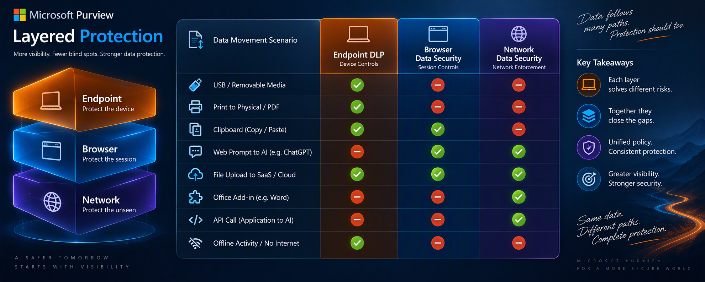

# Veri Artık Bir Dosya Değil

## Microsoft Purview Layered Protection ile Endpoint DLP, Browser Data Security ve Network Data Security Katmanlarında Modern Veri Koruma Mimarisi

<p align="center">
  
</p>

Microsoft Purview Layered Protection ile veri hareketlerinin cihaz, tarayıcı ve ağ seviyesinde korunmasını; Endpoint DLP'den Browser Data Security'ye ve Network Data Security'ye uzanan yeni nesil veri koruma mimarisinin teknik analizi üzerinden ele alan öğrenme odaklı bir çalışma.

<p align="center">
  
</p>

## Makaleyi oku

➡️ **[Teknik makaleyi aç](docs/article.md)**

## Makalenin kapsamı

- Endpoint DLP, Browser Data Security ve Network Data Security rolleri
- Üç katman arasındaki görünürlük ve yaptırım farkları
- “The Void” olarak tanımlanan denetim boşluğu
- Office eklentileri, yerel uygulamalar ve API çağrıları
- Örnek müşteri PoC tasarımı
- Politika karar akışı ve kademeli devreye alma
- Teknik uyarılar, bağımlılıklar ve ürün sınırlamaları
- GitHub uyumlu Mermaid mimari diyagramları

## Depo yapısı

```text
.
├── README.md
├── docs
│   └── article.md
└── assets
    ├── emre-erbulmus-logo.png
    ├── architecture.png
    ├── layered-protection.png
    ├── the-void.png
    ├── office-addin.png
    └── coverage-matrix.png
```

## Yazar

**Emre Erbulmuş**  
Microsoft Purview, Data Loss Prevention, Information Protection ve veri güvenliği mimarileri üzerine çalışmalar yürütmektedir.

[emreerbulmus.com](https://www.emreerbulmus.com)

## Kullanım notu

Bu çalışma teknik öğrenme ve mimari değerlendirme amacıyla hazırlanmıştır. Ürün yetenekleri, lisanslama koşulları, önizleme durumu ve desteklenen entegrasyonlar değişebileceği için üretim uygulamasından önce güncel Microsoft belgeleri doğrulanmalıdır.
