                                                                        # Veri Artık Bir Dosya Değil

## Microsoft Purview Layered Protection ile Endpoint DLP, Browser Data Security ve Network Data Security Katmanlarında Modern Veri Koruma Mimarisi

> Bir dosyanın USB belleğe kopyalanmasını engellemek veri güvenliğinin yalnızca bir bölümüdür. Aynı veri bir yapay zekâ istemine, Office eklentisine, yerel uygulamaya veya API isteğine dönüştüğünde korumanın farklı bir katmanda devam etmesi gerekir.

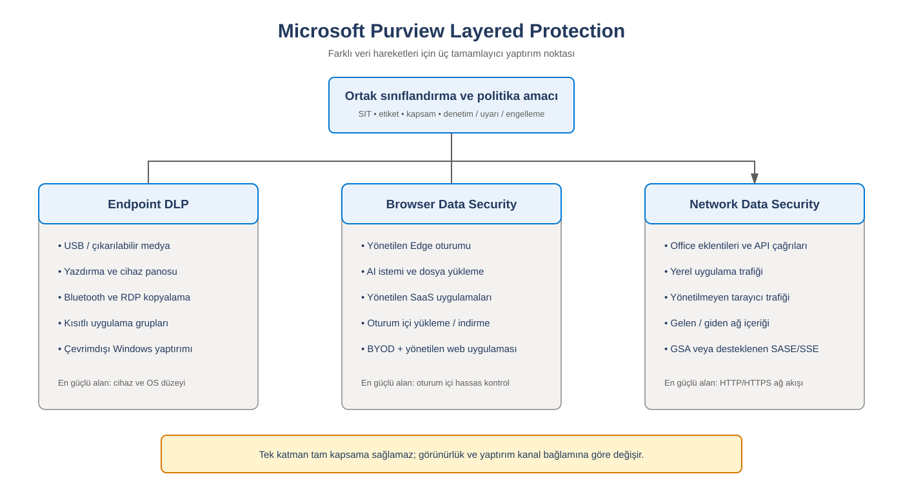

*Şekil 1. Endpoint, tarayıcı ve ağ katmanlarının ortak sınıflandırma ve politika amacı altında konumlandırılması.*

> [!NOTE]
> Bu makale teknik öğrenme ve mimari değerlendirme amacıyla hazırlanmıştır. Ürün özellikleri, lisans gereksinimleri, desteklenen uygulamalar ve önizleme durumları değişebileceği için üretim tasarımından önce güncel Microsoft belgeleri doğrulanmalıdır.

## İçindekiler

1. [Neden katmanlı veri koruması?](#1-neden-katmanlı-veri-koruması)
2. [Örnek olay: Kaçmaya çalışan finans raporu](#2-örnek-olay-kaçmaya-çalışan-finans-raporu)
3. [Üç koruma katmanının teknik rolü](#3-üç-koruma-katmanının-teknik-rolü)
4. [The Void: Görünürlük ve yaptırım boşluğu](#4-the-void-görünürlük-ve-yaptırım-boşluğu)
5. [Politika karar akışı](#5-politika-karar-akışı)
6. [Kapsama matrisi](#6-kapsama-matrisi)
7. [Müşteri ortamında PoC tasarımı](#7-müşteri-ortamında-poc-tasarımı)
8. [Üretim mimarisi ve kademeli geçiş](#8-üretim-mimarisi-ve-kademeli-geçiş)
9. [İzleme ve operasyon](#9-izleme-ve-operasyon)
10. [Teknik uyarılar ve ürün sınırlamaları](#10-teknik-uyarılar-ve-ürün-sınırlamaları)
11. [Sonuç](#11-sonuç)
12. [Kaynakça](#kaynakça)

---

## 1. Neden katmanlı veri koruması?

Geleneksel DLP tasarımlarında veri çoğunlukla bir dosya, e-posta eki veya cihaz üzerindeki kullanıcı işlemi olarak değerlendirilirdi. Bu yaklaşım USB, yazdırma, pano ve belirli dosya aktarım kanalları için hâlâ kritiktir. Ancak modern iş akışlarında hassas içerik aynı zamanda web formuna yazılan metin, üretken yapay zekâ istemi, masaüstü uygulamasının ağ trafiği, Office eklentisinin API isteği veya SaaS oturumundaki dosya yükleme işlemi olabilir.

Modern veri güvenliği mimarisinde iki temel soru birlikte yanıtlanmalıdır:

1. **İçerik nedir?** Hassas bilgi türü, duyarlılık etiketi, eğitilebilir sınıflandırıcı veya başka bir sınıflandırma mekanizması ne söylüyor?
2. **İçerik hangi kanaldan hareket ediyor?** Cihaz işlemi, tarayıcı oturumu, yerel uygulama veya ağ trafiği mi?

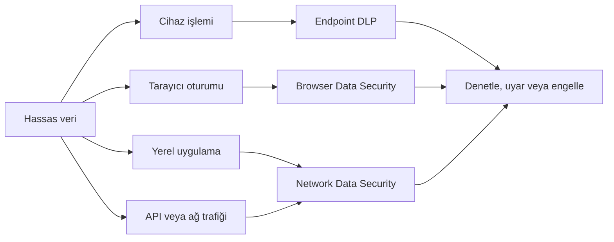

Bu yaklaşımda katmanlar birbirinin yerine geçmez. Her katman farklı bir etkinlik bağlamına ve yaptırım noktasına sahiptir.

Katmanlı tasarımın teknik hedefi, aynı sınıflandırma amacını farklı enforcement noktalarına taşımaktır. Örneğin aynı “Çok Gizli” etiketli dosya USB'ye kopyalanırken Endpoint DLP tarafından, yönetilen Edge oturumunda bir AI servisine yüklenirken Browser Data Security tarafından, Office eklentisinin oluşturduğu desteklenen API trafiğinde ise Network Data Security tarafından değerlendirilebilir. Ancak bu tutarlılık otomatik değildir. Kullanıcı kapsamı, uygulama kapsamı, veri sınıflandırması, trafik yönlendirmesi, politika modu ve lisanslama her katmanda ayrı doğrulanmalıdır.

Bu nedenle müşteri tasarımında yalnızca “DLP politikamız var mı?” sorusu yeterli değildir. Aşağıdaki sorular da cevaplanmalıdır:

- Hassas veriyi hangi sınıflandırma mekanizması tanıyacak?
- Veri hangi cihaz, uygulama, tarayıcı ve ağ yollarından hareket edebilir?
- Her yolda görünürlük mü, denetim mi, uyarı mı, yoksa kesin engelleme mi bekleniyor?
- Olay hangi portal veya günlük üzerinden doğrulanacak?
- Bir katman devre dışı kaldığında hangi artık risk kalacak?

!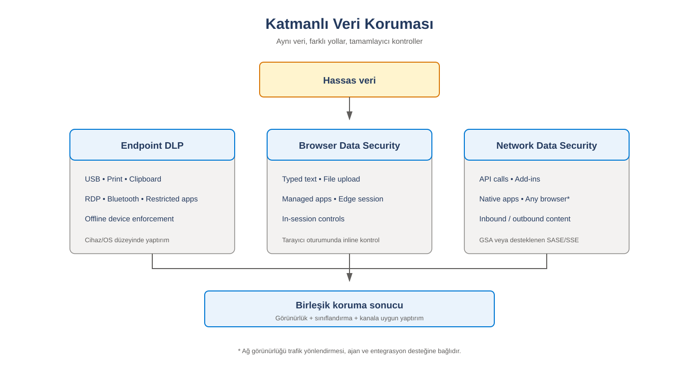

*Şekil 2. Aynı hassas verinin farklı hareket kanallarında tamamlayıcı kontrollerle korunması.*

---

## 2. Örnek olay: Kaçmaya çalışan finans raporu

Bir finans kullanıcısının müşteri adı, T.C. kimlik numarası, IBAN, ödeme kartı ve maaş bilgileri içeren bir Excel raporu hazırladığını düşünelim. Dosyaya kurumun sınıflandırma taksonomisine göre **Çok Gizli** etiketi uygulanmıştır. İçerikte ayrıca Purview tarafından algılanabilecek hassas bilgi türleri bulunmaktadır.

Kullanıcının amacı kötü niyetli olmak zorunda değildir. Kullanıcı veriyi analiz ettirmek, özetlemek veya başka bir uygulamada kullanmak isteyebilir. DLP açısından önemli olan yalnızca niyet değil, içerik ile veri hareketinin birlikte oluşturduğu risktir.

### 2.1 USB aktarımı

Kullanıcı dosyayı çıkarılabilir medyaya kopyalamaya çalışır. Bu, cihaz bağlamındaki bir eylemdir. Endpoint DLP; dosyanın içeriği, etiketi, kullanıcı kapsamı, cihaz durumu ve hedef aktivite üzerinden politika kararı üretebilir.

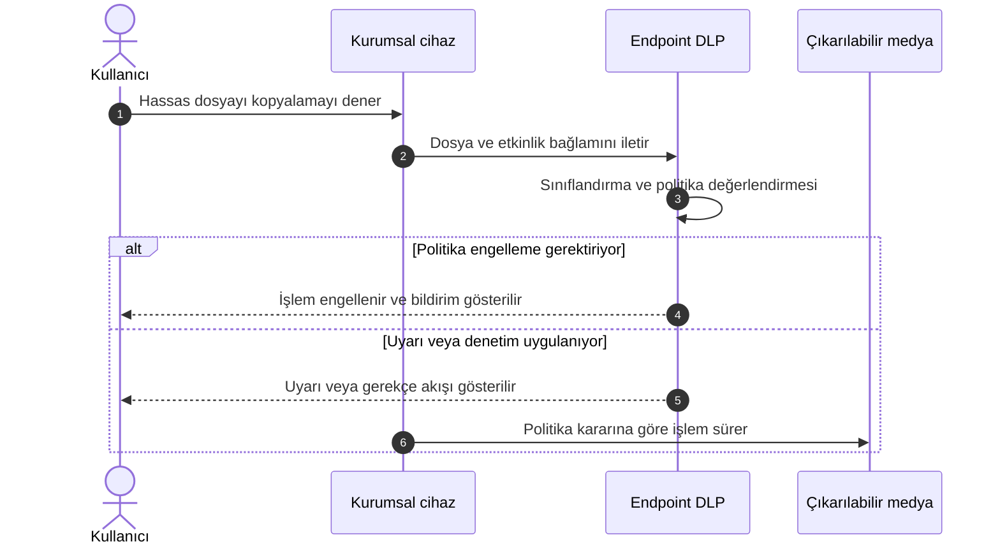

### 2.2 Web tabanlı yapay zekâ istemi

Kullanıcı aynı içeriği bir tüketici yapay zekâ uygulamasının web arayüzüne yapıştırır. Veri artık dosya transferi değil, tarayıcı oturumundaki yazılı içeriktir. Tarayıcı katmanı, desteklenen senaryolarda yazılan metin veya dosya yükleme hareketine paylaşım tamamlanmadan önce müdahale etmeyi hedefler.

### 2.3 Office eklentisi veya yerel uygulama

Kullanıcı belgeyi Word içinde açar ve üçüncü taraf bir eklentiyle özetletir. Eklenti belge içeriğini bir API çağrısına dönüştürebilir. Kullanıcı tarayıcı açmamış ve USB kullanmamıştır. Böyle bir desen, cihaz ve tarayıcı denetimlerinin dışında kalabilecek bir ağ akışı oluşturabilir.

!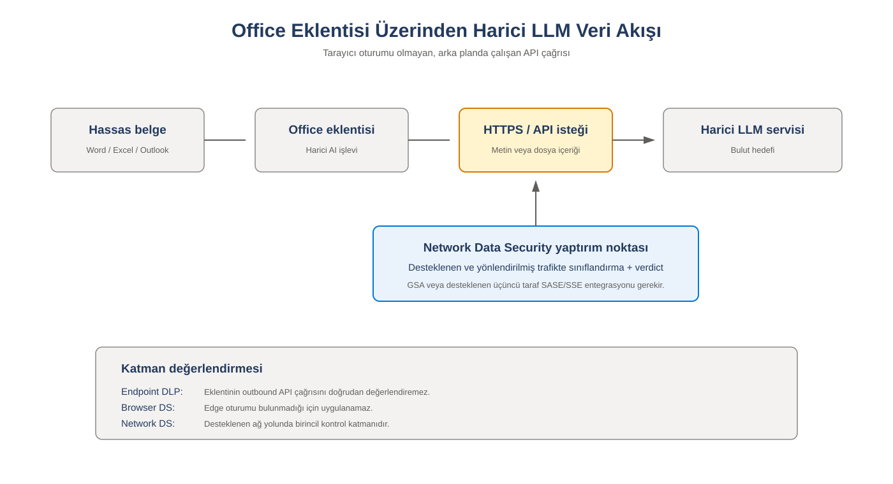

*Şekil 3. Office eklentisinin harici LLM servisine yaptığı API çağrısında ağ katmanının konumu.*

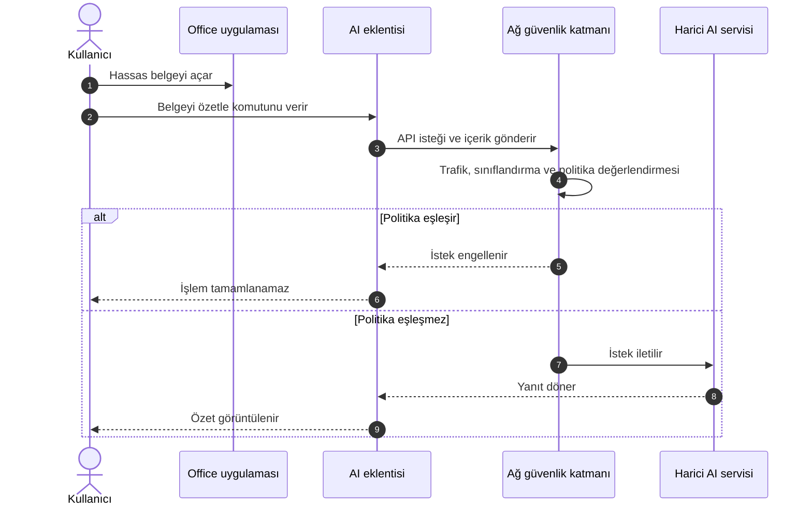

> [!IMPORTANT]
> Bu akış kavramsaldır. Gerçek görünürlük; desteklenen uygulamaya, trafik yönlendirmesine, şifreli trafik işleme yaklaşımına, kullanılan SASE veya proxy entegrasyonuna ve güncel ürün destek matrisine bağlıdır.

---

## 3. Üç koruma katmanının teknik rolü

### 3.1 Endpoint DLP

Endpoint DLP, cihaz üzerinde gerçekleşen hassas veri aktivitelerine odaklanır. Tasarım alanları çıkarılabilir medya, yazdırma, pano, ağ paylaşımı ve uygulama tabanlı dosya işlemlerini içerebilir. Endpoint katmanının ayırt edici özelliği, işlemi kullanıcı ve cihaz bağlamıyla ilişkilendirmesidir.

Politika tasarımında aşağıdaki bileşenler birlikte değerlendirilmelidir:

- Hassas bilgi türleri ve güven düzeyi
- Eşleşme adedi ve destekleyici kanıtlar
- Duyarlılık etiketleri
- Kullanıcı ve grup kapsamı
- Cihaz onboarding ve configuration durumu
- Hedef domain, uygulama veya cihaz grubu
- Denetim, uyarı, gerekçeli geçersiz kılma ve engelleme davranışı
- Politika önceliği ve istisnalar

Endpoint DLP, ağ katmanının alternatifi değildir. Çevrimdışı veya yerel cihaz aktivitelerinde ağ denetiminin göremeyeceği bağlamı sağlar.

### 3.2 Browser Data Security

Browser Data Security, desteklenen tarayıcı ve oturum senaryolarında kullanıcının hassas veriyi bir web uygulamasına yazdığı, yapıştırdığı, yüklediği veya indirdiği noktaya odaklanır. Tarayıcı katmanının değeri, kullanıcı etkileşimi sırasında politika uygulayabilmesidir.

Tasarım sırasında şu konular netleştirilmelidir:

- Kurumsal olarak desteklenen tarayıcı
- Edge for Business veya gerekli uzantı yönetimi
- Kurumsal cihaz ve BYOD ayrımı
- Yönetilen ve yönetilmeyen uygulama tanımları
- Domain grupları ve bulut uygulaması kategorileri
- Kullanıcıya gösterilecek politika mesajı
- Gerekçeli geçersiz kılma ve istisna süreci

Browser Data Security iki farklı güven modelinde ele alınmalıdır. Yönetilen cihaz üzerindeki yönetilmeyen uygulama senaryosunda cihazın Intune tarafından yönetilmesi, desteklenen Edge sürümü, doğru Purview kapsamı ve gerekli yapılandırma ilkeleri önemlidir. Yönetilmeyen cihaz üzerindeki yönetilen uygulama senaryosunda ise Entra Conditional Access, yönetilen uygulama, Edge for Business çalışma profili ve oturum denetimleri birlikte tasarlanır.

Tarayıcı katmanının güçlü yanı, içeriği gönderimden önce oturum bağlamında değerlendirebilmesidir. Ancak bu, her tarayıcının veya her uygulamanın aynı seviyede desteklendiği anlamına gelmez. Chrome veya Firefox için uzantı ve yönlendirme davranışları, yönetilen Edge oturumundaki inline içerik denetimiyle aynı kabul edilmemelidir. PoC sırasında “hangi tarayıcı, hangi uygulama, hangi aktivite ve hangi kullanıcı deneyimi?” soruları ayrı test vakaları olarak ele alınmalıdır.

### 3.3 Network Data Security

Network Data Security, veri hareketini ağ üzerinden değerlendiren katmandır. Özellikle tarayıcı dışı uygulamalar, eklentiler, API tabanlı iletişim ve desteklenen yerel uygulama trafiği için önem kazanır.

Bu katmanın çalışması yalnızca Purview politikasına bağlı değildir. Trafiğin desteklenen bir ağ güvenliği mimarisinden geçirilmesi ve gerekli entegrasyonların sağlanması gerekir. Üçüncü taraf SASE veya proxy çözümü kullanılıyorsa yetenek kullanılabilirliği ilgili sağlayıcıyla doğrulanmalıdır.

Network Data Security tasarımında en az dört teknik düzlem birlikte değerlendirilmelidir:

1. **Trafik yönlendirme:** İlgili internet veya uygulama trafiği Entra Global Secure Access istemcisi ya da desteklenen üçüncü taraf SASE/SSE yolu üzerinden geçmelidir.
2. **TLS inceleme:** Şifreli trafiğin içerik düzeyinde değerlendirilebilmesi için TLS inspection tasarımı, sertifika güveni, istisnalar ve certificate pinning kullanan uygulamalar ele alınmalıdır.
3. **İçerik politikası:** Ağ güvenliği katmanı hangi hedef ve aktivitenin Purview değerlendirmesine gönderileceğini belirlemelidir. Her trafik akışının Purview'a gönderilmesi performans, maliyet ve gizlilik açısından doğru olmayabilir.
4. **Purview verdict:** Aktif DLP kuralı, sınıflandırma sonucu ve politika aksiyonu birlikte değerlendirilerek audit veya block kararı üretilir.

Entra Global Secure Access ile Purview kullanıldığında traffic forwarding profile, TLS inspection policy, content policy, security profile ve Conditional Access ilişkisi uçtan uca test edilmelidir. Üçüncü taraf SASE/SSE entegrasyonlarında ise desteklenen aktiviteler, bildirim davranışı ve enforcement seviyeleri sağlayıcının entegrasyon derinliğine bağlıdır.

Ağ katmanının güçlü olduğu nokta, tarayıcı oturumu bulunmayan API ve yerel uygulama trafiğine erişebilmesidir. Buna karşılık USB, yerel yazdırma ve çevrimdışı dosya hareketleri ağ üzerinde oluşmadığından Network Data Security tarafından görülemez. Bu sınır, katmanlı mimarinin neden gerekli olduğunu açıkça gösterir.

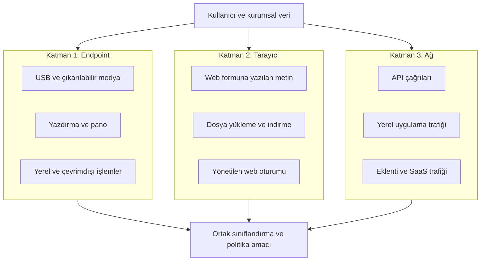

---

## 4. The Void: Görünürlük ve yaptırım boşluğu

“The Void”, tek bir koruma katmanının göremediği veya eylem uygulayamadığı veri çıkış noktalarını anlatan mimari bir kavramdır. Temel risk, ürünün hiç çalışmaması değil, kurumun mevcut kapsamı olduğundan daha geniş varsaymasıdır.

!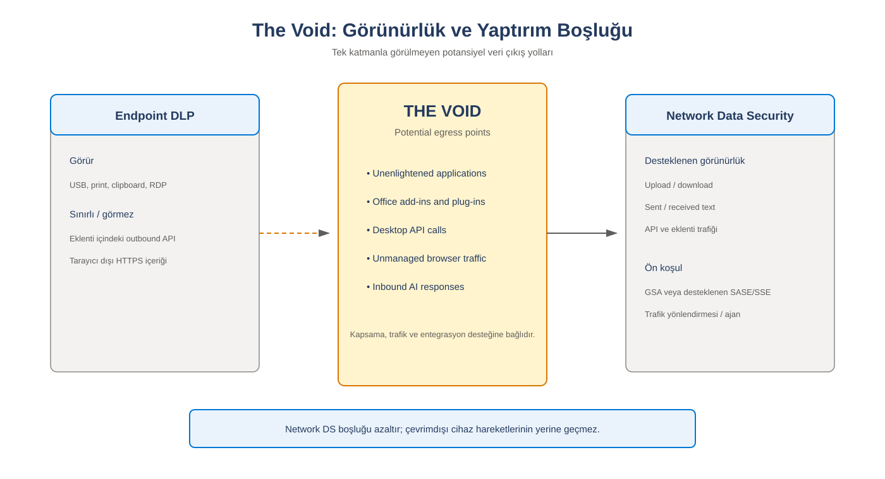

*Şekil 4. Endpoint ve tarayıcı kontrollerinin doğrudan kapsamadığı potansiyel veri çıkış yolları.*

Örnek boşluklar:

- Endpoint politikasının dosya eylemini gördüğü, ancak uygulama içindeki API aktarımını göremediği durumlar
- Tarayıcı politikasının web oturumunu gördüğü, ancak yerel masaüstü uygulamasını göremediği durumlar
- Ağ katmanının trafiği gördüğü, ancak çevrimdışı USB veya yazdırma eylemine müdahale edemediği durumlar
- İçeriğin şifreleme, uygulama davranışı veya desteklenmeyen protokol nedeniyle sınıflandırılamadığı durumlar

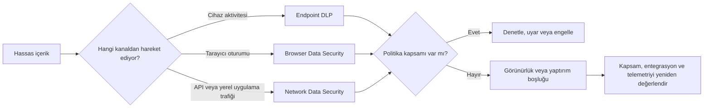

### The Void neden oluşur?

Görünürlük boşluğu çoğu zaman tek bir ürün hatasından değil, veri hareketi ile enforcement noktasının uyuşmamasından oluşur. Endpoint DLP dosyanın cihaz üzerindeki hareketini değerlendirebilir, fakat eklentinin süreç içinden oluşturduğu API çağrısını dosya kopyalama aktivitesi olarak görmeyebilir. Browser Data Security tarayıcı oturumunda güçlüdür, fakat yerel uygulamanın arka plan HTTPS çağrısında Edge oturumu bulunmaz. Network Data Security bu trafiği değerlendirebilir, ancak trafik desteklenen yoldan geçmiyorsa veya TLS içeriği incelenemiyorsa görünürlük yine oluşmaz.

Bu nedenle “The Void” sabit bir ürün listesi değildir. Kurumun cihaz yönetimi, uygulama portföyü, tarayıcı standardı, ağ mimarisi, şifreleme yaklaşımı ve entegrasyon kapsamına göre değişen bir risk alanıdır.

### Coverage mapping nasıl yapılmalıdır?

Müşteri tasarımında bu kavramın karşılığı bir **coverage mapping** çalışmasıdır. Kritik veri türleri satırlara, veri çıkış kanalları sütunlara yazılır. Her hücre için aşağıdaki bilgiler kaydedilir:

- Veri türü, etiket veya SIT
- Kaynak cihaz ve yönetim durumu
- Kullanılan uygulama ve tarayıcı
- Hedef servis veya domain
- Beklenen kontrol katmanı
- Beklenen politika aksiyonu
- Gerekli lisans ve teknik ön koşul
- Olayın doğrulanacağı portal veya günlük
- Negatif test ve bypass testi
- Kontrol uygulanamazsa kalan artık risk

Coverage mapping çalışmasının çıktısı, yalnızca “covered” veya “not covered” olmamalıdır. “Koşullu”, “önizleme”, “sağlayıcıya bağlı”, “yalnızca audit” ve “yalnızca yönetilen cihaz” gibi durumlar açıkça işaretlenmelidir. Böylece PoC sonucunun üretim kapsamıymış gibi yorumlanması engellenir.

---

## 5. Politika karar akışı

Tüm politikaları ilk günden engelleme moduna almak doğru bir başlangıç değildir. Önce sınıflandırma kalitesi, olay hacmi, yanlış pozitifler ve iş istisnaları doğrulanmalıdır.

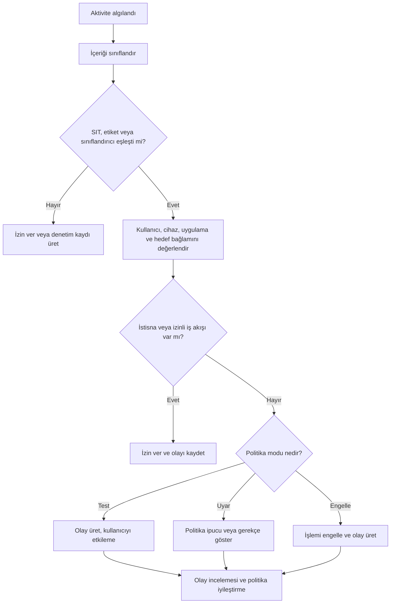

### Sınıflandırma tasarım notları

- Tek bir SIT eşleşmesi her zaman yeterli güven sunmayabilir.
- Güven düzeyi, eşleşme adedi ve destekleyici kanıtlar birlikte değerlendirilmelidir.
- Etiket tabanlı politika, etiketleme disiplinine bağlıdır.
- Etiketsiz hassas içerik için içerik tabanlı sınıflandırma gerekir.
- Geniş anahtar kelime listeleri yanlış pozitif hacmini artırabilir.
- İstisnaların sahibi, gerekçesi ve gözden geçirme tarihi bulunmalıdır.

---

## 6. Kapsama matrisi

!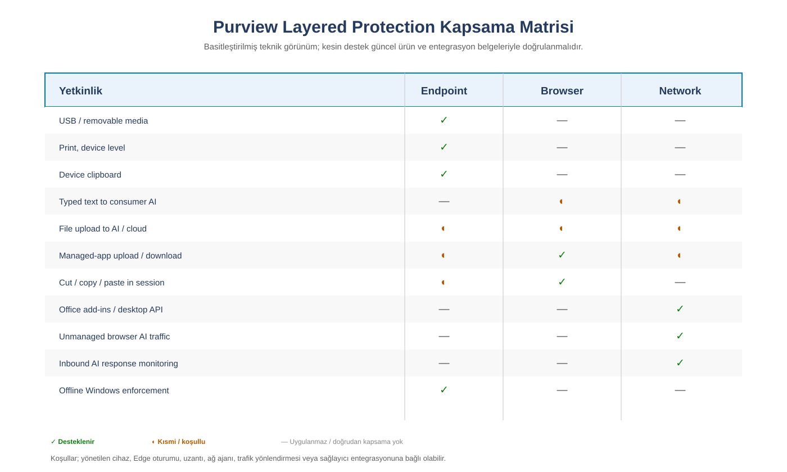

*Şekil 5. Endpoint, Browser ve Network katmanlarının basitleştirilmiş yetenek karşılaştırması.*

Aşağıdaki tablo kavramsal tasarım içindir. Kesin ürün desteği olarak kullanılmamalı ve güncel resmi belgelerle doğrulanmalıdır.

| Senaryo | Birincil katman | İkincil katman | Tasarım notu |
|---|---|---|---|
| USB veya çıkarılabilir medya | Endpoint | Yok | Cihaz onboarding ve politika dağıtımı doğrulanmalıdır. |
| Yazdırma | Endpoint | Yok | Yazıcı grupları ve iş istisnaları planlanmalıdır. |
| Web formuna hassas metin yapıştırma | Tarayıcı | Ağ | Tarayıcı ve domain desteği doğrulanmalıdır. |
| Web uygulamasına dosya yükleme | Tarayıcı veya Endpoint | Ağ | Uygulama, tarayıcı ve hedef domain davranışı test edilmelidir. |
| Office eklentisinin API çağrısı | Ağ | Uygulamaya bağlı | Trafik yönlendirmesi ve desteklenen entegrasyon gerekir. |
| Yerel AI uygulaması | Ağ | Endpoint kapsamına bağlı | Uygulama ve ağ akışı ayrı test edilmelidir. |
| Çevrimdışı dosya hareketi | Endpoint | Yok | Ağ katmanı çevrimdışı hareketi göremez. |
| BYOD üzerinde yönetilen web oturumu | Tarayıcı ve erişim denetimi | Ağ | Kimlik, oturum ve cihaz güveni birlikte tasarlanmalıdır. |

---

## 7. Müşteri ortamında PoC tasarımı

PoC'nin amacı yalnızca bir engelleme bildirimi göstermek değildir. Amaç, her katmanın hangi veri hareketini gördüğünü, olayın nerede kaydedildiğini ve hangi durumda diğer katmana ihtiyaç duyulduğunu kanıtlamaktır.

### 7.1 Başarı kriterleri

1. Test kullanıcısı, cihazı ve uygulaması tanımlıdır.
2. Test verisi sentetiktir ve gerçek kişisel veri içermez.
3. Beklenen sınıflandırma sonucu tanımlıdır.
4. Beklenen kullanıcı deneyimi bellidir.
5. Politika eşleşmesi ilgili olay görünümünde doğrulanabilir.
6. Olay zaman damgası ve politika adıyla ilişkilendirilebilir.
7. Eşleşmemesi gereken negatif test başarıyla tamamlanır.
8. İzinli iş akışı ve kontrollü istisna ayrıca test edilir.

### 7.2 Örnek testler

| Test | Kanal | Beklenen sonuç | Doğrulama |
|---|---|---|---|
| T01 | Hassas dosyayı USB'ye kopyalama | Engelleme veya uyarı | Endpoint DLP olayı |
| T02 | Hassas metni web AI istemine yapıştırma | Tarayıcı politikası kararı | Kullanıcı bildirimi ve olay kaydı |
| T03 | Hassas dosyayı web uygulamasına yükleme | Politika kapsamına göre karar | DLP olayı ve hedef domain |
| T04 | Hassas belgeyi Office eklentisiyle işleme | Ağ katmanı kararı | Ağ ve Purview telemetrisi |
| T05 | Hassas olmayan kontrol dosyası | İzin | Yanlış pozitif oluşmaması |
| T06 | Yetkili iş uygulamasına aktarım | İzin veya gerekçeli geçiş | İstisna kaydı |

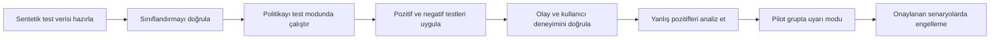

> [!CAUTION]
> PoC sırasında gerçek müşteri kayıtları, gerçek kimlik numaraları veya gerçek ödeme kartı verileri kullanılmamalıdır. Gerçek kişilere ait olmayan sentetik test verileri tercih edilmelidir.

---

## 8. Üretim mimarisi ve kademeli geçiş

### Faz 1: Veriyi tanı

- Veri envanteri ve kritik iş süreçleri çıkarılır.
- Duyarlılık etiketi taksonomisi oluşturulur.
- SIT, Exact Data Match, fingerprint ve diğer sınıflandırma yöntemleri değerlendirilir.
- Veri sahipleri ve politika sahipleri belirlenir.

### Faz 2: Görünürlük oluştur

- Politikalar test veya denetim modunda çalıştırılır.
- Endpoint onboarding ve configuration durumları izlenir.
- Tarayıcı, uygulama ve domain kapsamı doğrulanır.
- Ağ entegrasyonunda trafik akışı ve telemetri kontrol edilir.

### Faz 3: Kullanıcı etkisini ölç

- Politika bildirimleri iş diline uygun hazırlanır.
- Gerekçeli geçersiz kılma yalnızca gerekli senaryolarda kullanılır.
- Servis hesapları ve iş uygulamaları için kontrollü istisnalar oluşturulur.
- Help desk ve olay müdahale akışı hazırlanır.

### Faz 4: Kademeli yaptırım

- Önce yüksek güvenli sınıflandırmalar ve yüksek riskli kanallar engellenir.
- Pilot kullanıcı ve cihaz grupları kademeli genişletilir.
- Her değişiklik ölçüm, onay ve geri dönüş planıyla yapılır.

### Faz 5: Sürekli iyileştirme

- Yanlış pozitif ve yanlış negatif örnekleri incelenir.
- Yeni AI uygulamaları ve SaaS servisleri için kapsam güncellenir.
- İstisnalar periyodik olarak gözden geçirilir.
- Politika sahipliği ve değişiklik kayıtları korunur.

---

## 9. İzleme ve operasyon

Katmanlı koruma yalnızca politika yazımıyla tamamlanmaz. Operasyon ekibi olayın hangi katmanda üretildiğini ayırt edebilmelidir.

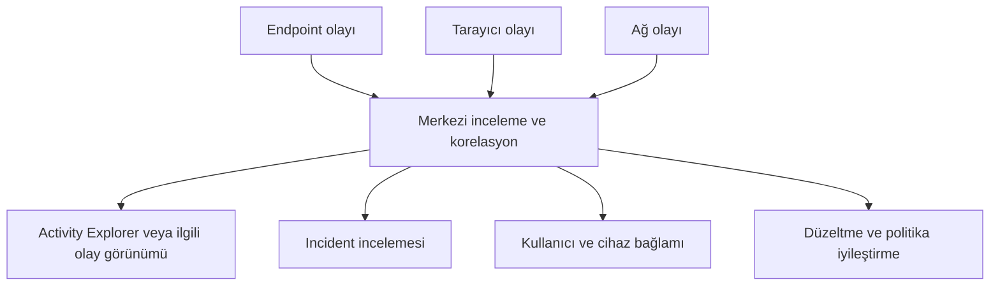

Operasyon prosedüründe en az şu bilgiler yer almalıdır:

- Politika ve kural adı
- Sınıflandırma türü ve güven seviyesi
- Kullanıcı, cihaz ve uygulama bağlamı
- Hedef domain veya servis
- Uygulanan aksiyon
- Kullanıcı geçersiz kılma veya gerekçe bilgisi
- Olayın tekrar sıklığı
- İş birimi ve veri sahibi
- Kapatma nedeni ve alınan aksiyon

---

## 10. Collection Policies: Telemetri Toplama ile Enforcement Arasındaki Ayrım

Collection Policy, DLP engelleme politikasının eş anlamlısı değildir. Collection Policy'nin amacı hangi etkinliklerin Purview sinyal ve audit akışına alınacağını belirlemektir. DLP policy ise belirli koşullar altında kullanıcı aktivitesine uygulanacak denetim, uyarı veya engelleme kararını yönetir.

Bu ayrım mimari açıdan kritiktir:

- **Collection plane**, hangi olayın toplanacağını ve aşağı akış çözümlerine sunulacağını belirler.
- **Enforcement plane**, kullanıcı aktivitesi gerçekleşirken izin, audit veya block kararını uygular.
- Bir olayın Collection Policy tarafından filtrelenmesi, DLP yaptırımının otomatik olarak devre dışı kaldığı anlamına gelmez.
- Buna karşılık toplanmayan bir olay Activity Explorer, Insider Risk Management veya audit tabanlı başka deneyimlerde görünmeyebilir.

### Collection Policy değerlendirme mantığı

Bir collection event temel olarak koşul, aktivite ve veri kaynağı bağlamından oluşur. Örneğin “içerik belirli bir SIT içeriyor” koşulu ile “dosya çıkarılabilir medyaya kopyalandı” aktivitesi aynı olay tanımında değerlendirilebilir. Eşleşen olay signal store'a alınır; eşleşmeyen olay ingestion öncesinde elenir.

Bu yaklaşımın faydaları şunlardır:

- Gereksiz olay hacmini ve analist gürültüsünü azaltmak
- Yalnızca belirli veri türleri veya aktiviteler için odaklı telemetri toplamak
- Activity Explorer ve diğer tüketici çözümlerine daha anlamlı sinyal sağlamak
- AI, browser, network ve device kaynaklarını kontrollü biçimde kapsama almak

### Operasyonel uyarılar

Device collection politikaları tasarlanırken Endpoint DLP ayarlarında cihaz dosya aktivitelerinin audit edilmesi için gerekli yapılandırma doğrulanmalıdır. Ayrıca Insider Risk Management cihaz göstergeleriyle olası etkileşimler incelenmelidir. Collection Policy tarafından elenen bir olayın aşağı akış çözümünde görünmeyeceği unutulmamalıdır.

Collection Policy devreye alınmadan önce aşağıdaki sorular cevaplanmalıdır:

1. Hangi veri kaynağından olay toplanacak?
2. Hangi koşul ve aktivite kombinasyonu değerli bir sinyal oluşturuyor?
3. Toplanan sinyali hangi çözüm tüketecek?
4. Filtreleme, mevcut IRM veya eDiscovery görünürlüğünü azaltıyor mu?
5. PAYG destekli bir kaynak veya koruma yolu etkinleşiyor mu?

---

## 11. Lisanslama ve Maliyet Modelinin Mimariye Etkisi

Lisanslama, katmanlı koruma tasarımından sonra kontrol edilecek ayrı bir idari konu değildir. Hangi katmanın hangi kullanıcı, cihaz, uygulama ve trafik üzerinde çalışabileceğini doğrudan etkileyen bir mimari girdidir.

### Endpoint DLP

Endpoint DLP yetkileri uygun Microsoft 365 ve Purview lisanslarına bağlıdır. Intune ve Entra ID, cihaz yönetimi ve kullanıcı kimliği bağlamı açısından tasarımın parçasıdır. OCR veya on-demand classification gibi bazı ek hizmetler tüketim bazlı olabilir.

### Browser Data Security

Yönetilen bulut uygulamaları ile yönetilmeyen tüketici AI uygulamaları aynı maliyet modeline sahip olmayabilir. Yönetilen uygulama senaryoları uygun lisans kapsamında olabilirken, yönetilmeyen AI uygulamalarında inline koruma PAYG metriğini kullanabilir. Edge for Business, Intune, Entra Conditional Access ve Defender for Cloud Apps bağımlılıkları senaryoya göre ayrıca doğrulanmalıdır.

### Network Data Security

Network Data Security için Purview DLP tarafına ek olarak desteklenen bir ağ güvenliği yolu gerekir. Bu, Entra Internet Access veya Entra Suite kapsamındaki Global Secure Access bileşenleri ya da Purview entegrasyonu sağlayan üçüncü taraf SASE/SSE çözümü olabilir. Routed traffic üzerinde inline değerlendirme PAYG maliyeti oluşturabilir.

### Tasarım önerisi

PoC başlamadan önce bir lisans ve tüketim matrisi hazırlanmalıdır. En az aşağıdaki alanlar yer almalıdır:

- Kullanıcı ve cihaz sayısı
- Kullanılan kontrol katmanı
- Gerekli temel lisans
- PAYG ile ölçülen aktivite
- GSA veya üçüncü taraf SASE/SSE maliyeti
- Veri toplama ve saklama beklentisi
- Pilot ve üretim için ayrı tüketim tahmini

Lisanslama ve ürün kapsamı değişebileceğinden nihai tasarım, güncel Microsoft Product Terms, Purview service description, PAYG belgeleri ve ilgili SASE sağlayıcısının destek dokümanlarıyla doğrulanmalıdır.

---

## 12. Teknik uyarılar ve ürün sınırlamaları

### 12.1 Tek katman tam kapsama sağlamaz

Endpoint, tarayıcı ve ağ katmanları farklı telemetri ve yaptırım noktalarına sahiptir. Bir katmanın devreye alınması diğer katmanların bağlamını otomatik olarak oluşturmaz.

### 12.2 Destek matrisi değişebilir

Desteklenen tarayıcılar, uygulamalar, eylemler, SASE sağlayıcıları ve politika seçenekleri ürün sürümüne göre değişebilir.

### 12.3 Şifreli trafik görünürlüğü otomatik değildir

HTTPS içeriğinin değerlendirilmesi trafik yönlendirme ve inceleme mimarisine bağlıdır. Sertifika dağıtımı, TLS istisnaları, certificate pinning, gizlilik ve mevzuat gereksinimleri ayrıca değerlendirilmelidir.

### 12.4 Sınıflandırma kalitesi yaptırım kalitesini belirler

Hatalı SIT, aşırı geniş eşik veya düşük kaliteli anahtar kelime mantığı yüksek yanlış pozitif üretebilir. Engelleme öncesinde pozitif ve negatif test setleriyle doğrulama yapılmalıdır.

### 12.5 Etiket tek başına yeterli olmayabilir

Etiketlenmemiş veya desteklenmeyen dosya biçimindeki hassas içerik için içerik tabanlı denetim gerekebilir.

### 12.6 BYOD ayrı bir güven modelidir

Kişisel cihazlarda kurumsal cihazla aynı ajan ve kontrol düzeyi bulunmayabilir. Kimlik, koşullu erişim, yönetilen tarayıcı ve oturum kontrolleri birlikte düşünülmelidir.

### 12.7 Network Data Security her trafiği otomatik olarak çözmez

Trafiğin görülmesi, içeriğin her koşulda sınıflandırılabileceği veya her uygulamada engellenebileceği anlamına gelmez. Protokol, şifreleme, uygulama davranışı ve entegrasyon sınırları PoC ile doğrulanmalıdır.

### 12.8 Lisanslama tasarımın parçasıdır

Purview, Entra ve üçüncü taraf ağ güvenliği bileşenlerinin lisans gereksinimleri farklı olabilir. Güncel ürün koşulları ve fiyatlandırma doğrulanmalıdır.

### 12.9 Telemetri toplama ile yaptırım aynı değildir

Bir aktivitenin raporlanması, aynı kanal üzerinde engelleme uygulanabileceği anlamına gelmeyebilir. PoC başarı kriterleri görünürlük ve yaptırım olarak ayrı yazılmalıdır.

### 12.10 Gizlilik ve çalışan izleme

Kullanıcı aktivitelerinin incelenmesi; yerel mevzuat, bilgilendirme, veri minimizasyonu ve rol tabanlı erişim gereksinimleriyle birlikte ele alınmalıdır.

---

## 13. Sonuç

Microsoft Purview Layered Protection yalnızca yeni bir DLP özelliği olarak değerlendirilmemelidir. Yaklaşımın asıl değeri, veri güvenliği problemini dosya merkezli bakıştan kanal ve akış merkezli bakışa taşımasıdır.

Endpoint katmanı cihazdaki yerel ve çevrimdışı işlemleri kontrol eder. Tarayıcı katmanı web oturumundaki paylaşım anına yaklaşır. Ağ katmanı ise tarayıcı dışında kalan uygulama, eklenti ve API trafiğindeki görünürlük boşluklarını azaltmayı hedefler.

Bir müşteride doğru başlangıç sorusu “Hangi ürünü açmalıyız?” değildir. Doğru sorular şunlardır:

- Hangi veri türlerini koruyoruz?
- Veri hangi iş süreçlerinde kullanılıyor?
- Hangi kanallardan kurum dışına çıkabilir?
- Her kanalda hangi kontrol görünürlük sağlıyor?
- Hangi kontrol gerçekten yaptırım uygulayabiliyor?
- Olayı nerede ve hangi kanıtla doğrulayacağız?
- İş sürekliliğini bozmadan nasıl kademeli geçiş yapacağız?

> **Veri artık yalnızca bir dosya değildir. Veri; cihazlar, tarayıcılar, uygulamalar ve ağlar arasında hareket eden bir akıştır. Güvenlik mimarisi de bu akışın her kritik noktasında görünürlük, sınıflandırma ve uygun yaptırım sağlayabildiği ölçüde etkilidir.**

---

## Kaynakça

1. [Close the gaps: Layered data protection with Microsoft Purview](https://techcommunity.microsoft.com/blog/microsoft-purview-blog/close-the-gaps-layered-data-protection-with-microsoft-purview-across-endpoint-br/4550997)
2. [Microsoft Purview Data Loss Prevention belgeleri](https://learn.microsoft.com/purview/dlp-learn-about-dlp)
3. [Endpoint DLP hakkında bilgi](https://learn.microsoft.com/purview/endpoint-dlp-learn-about)
4. [Microsoft Purview Information Protection](https://learn.microsoft.com/purview/information-protection)
5. [Microsoft Entra Global Secure Access](https://learn.microsoft.com/entra/global-secure-access/)
6. [GitHub üzerinde Mermaid diyagramları oluşturma](https://docs.github.com/get-started/writing-on-github/working-with-advanced-formatting/creating-diagrams)

---

## Yazar

**Emre Erbulmuş**  
Microsoft Purview, Data Loss Prevention, Information Protection ve veri güvenliği mimarileri üzerine çalışmalar yürütmektedir.

[emreerbulmus.com](https://www.emreerbulmus.com)
